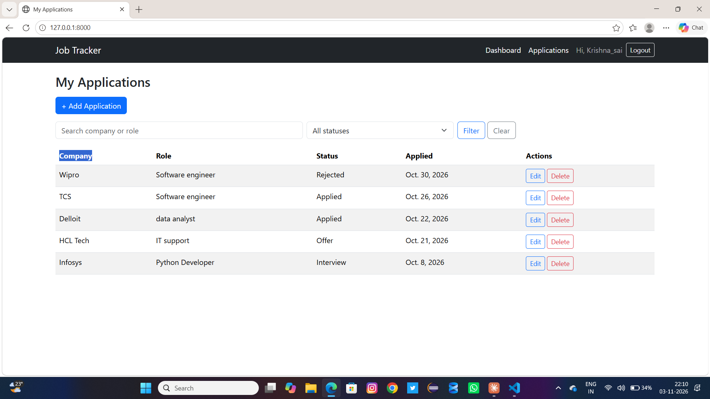
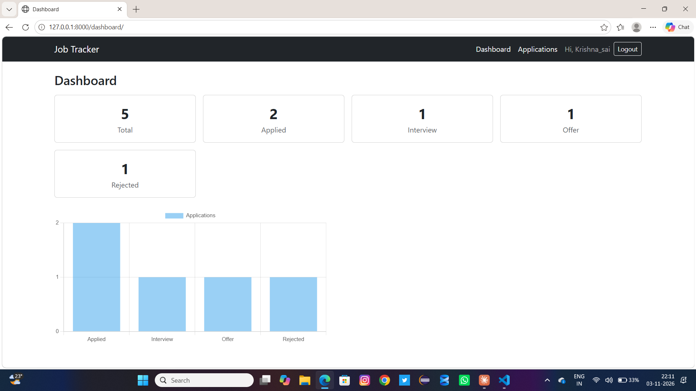
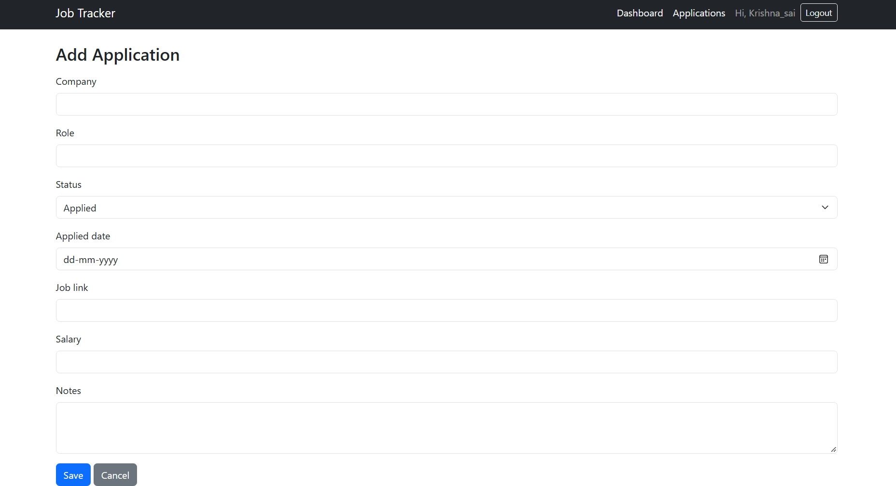

# Job Application Tracker

A full-stack web app built with Django that helps job seekers track their applications, interview stages and offers in one place.

**Live demo:** _coming soon_

## Features

- User signup, login and logout (Django authentication)
- Each user sees only their own applications
- Add, edit and delete applications (full CRUD)
- Search by company or role, and filter by status
- Dashboard with status counts and a bar chart
- Form validation and CSRF protection
- Responsive layout using Bootstrap

## Tech Stack

- **Backend:** Python, Django
- **Database:** SQLite (MySQL planned)
- **Frontend:** HTML, CSS, JavaScript, Bootstrap 5, Chart.js
- **Tools:** Git, GitHub, VS Code

## Screenshots

### Applications list


### Dashboard


### Add application form


## Run it locally

```bash
git clone https://github.com/krishnasai1718/job-tracker.git
cd job-tracker
python -m venv venv
venv\Scripts\activate        # Windows
pip install -r requirements.txt
python manage.py migrate
python manage.py runserver
```

Then open http://127.0.0.1:8000 and sign up for an account.

## What I learned

- Designing database models and relationships (one user has many applications)
- Securing views so users can only access their own data
- Building forms with validation using Django ModelForms
- Using the ORM for filtering, searching and aggregation

## Author

**Krishnasai**: [GitHub](https://github.com/krishnasai1718)# Job Application Tracker

A full-stack web app built with Django that helps job seekers track their applications, interview stages and offers in one place.

**Live demo:** _coming soon_

## Features

- User signup, login and logout (Django authentication)
- Each user sees only their own applications
- Add, edit and delete applications (full CRUD)
- Search by company or role, and filter by status
- Dashboard with status counts and a bar chart
- Form validation and CSRF protection
- Responsive layout using Bootstrap

## Tech Stack

- **Backend:** Python, Django
- **Database:** SQLite (MySQL planned)
- **Frontend:** HTML, CSS, JavaScript, Bootstrap 5, Chart.js
- **Tools:** Git, GitHub, VS Code

## Screenshots

### Applications list


### Dashboard


### Add application form


## Run it locally

```bash
git clone https://github.com/krishnasai1718/job-tracker.git
cd job-tracker
python -m venv venv
venv\Scripts\activate        # Windows
pip install -r requirements.txt
python manage.py migrate
python manage.py runserver
```

Then open http://127.0.0.1:8000 and sign up for an account.

## What I learned

- Designing database models and relationships (one user has many applications)
- Securing views so users can only access their own data
- Building forms with validation using Django ModelForms
- Using the ORM for filtering, searching and aggregation

## Author

**Krishnasai**: [GitHub](https://github.com/krishnasai1718)# Job Application Tracker

A full-stack web app built with Django that helps job seekers track their applications, interview stages and offers in one place.

**Live demo:** _coming soon_

## Features

- User signup, login and logout (Django authentication)
- Each user sees only their own applications
- Add, edit and delete applications (full CRUD)
- Search by company or role, and filter by status
- Dashboard with status counts and a bar chart
- Form validation and CSRF protection
- Responsive layout using Bootstrap

## Tech Stack

- **Backend:** Python, Django
- **Database:** SQLite (MySQL planned)
- **Frontend:** HTML, CSS, JavaScript, Bootstrap 5, Chart.js
- **Tools:** Git, GitHub, VS Code

## Screenshots

### Applications list


### Dashboard


### Add application form


## Run it locally

```bash
git clone https://github.com/krishnasai1718/job-tracker.git
cd job-tracker
python -m venv venv
venv\Scripts\activate        # Windows
pip install -r requirements.txt
python manage.py migrate
python manage.py runserver
```

Then open http://127.0.0.1:8000 and sign up for an account.

## What I learned

- Designing database models and relationships (one user has many applications)
- Securing views so users can only access their own data
- Building forms with validation using Django ModelForms
- Using the ORM for filtering, searching and aggregation

## Author

**Krishnasai**: [GitHub](https://github.com/krishnasai1718)